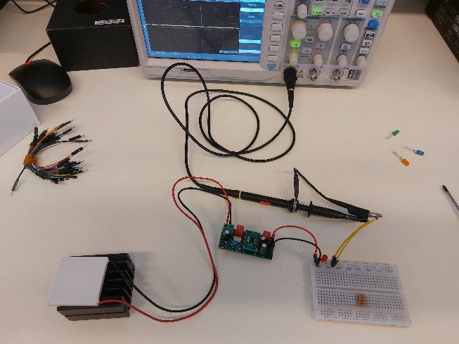

## Greetings traveler 👋

I'm Robert, a recent Electrical and Computer engineering graduate. 

I enjoy designing hardware and writing low-level software. Each day I try to learn something new.

Sometimes when I have to give a present I usually build engineer something. Either I write a simple software,prototype hardware or I use both.

The things I like :       

I've competed in hardware competitions.

I've worked with a research team in extending the reading range of an RFID and co-authored in a research paper.

Fun facts:
- I speak three languages fluently : Hungarian, Serbian and English.
- I love classic literature
- I am half left handed and half right handed

<h2 align="center">Some of my projects</h2>

<table width="100%">
<tr>

<!-- PROJECT 1 -->
<td width="40%" valign="top">

### Electrical measuring system

Electrical measuring system for AC/DC voltage, active and reactive power, and frequency.

`C` · `STM32` · `ATM90E26` · `KiCad`
</td>

<!-- PROJECT 2 -->
<td width="60%" valign="top">

### Greenhouse automation

Arduino-based greenhouse monitoring and automation system.

`C` · `STM32` · `PCB Design` · `Altium`
</td>

</tr>

<tr>

<!-- PROJECT 3 -->
<td width="50%" valign="top">

  
### Energy Harvesting

Research project involving thermoelectric and piezoelectric energy harvesting.

`Energy harvesting` · `PCB Design`
</td>

<!-- PROJECT 4 -->
<td width="50%" align="center" valign="top">

### ROS2 Cube Sorting

Autonomous robotic system for detecting and sorting colored cubes.

`ROS2` · `Python`
</td>

</tr>

<tr>

<!-- PROJECT 5 -->
<td colspan="2" align="center">

### Birch antenna

An antenna based on birch bark substrate. 

`Antenna` · `RF` · `CST`
</td>

</tr>
</table>
